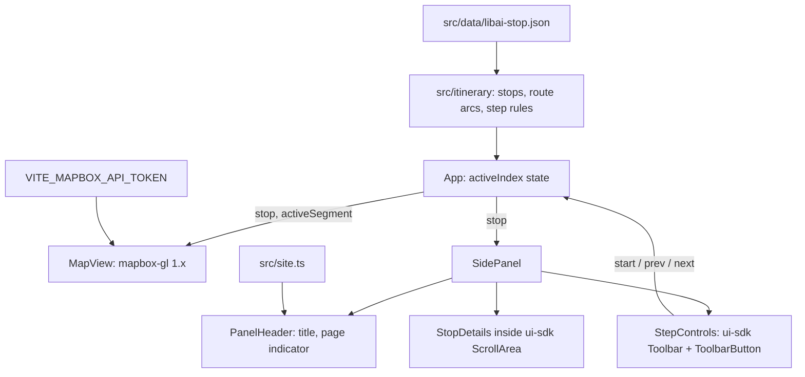

# Gatsby to Vite + React 19 + ui-sdk Migration - Plan

## Goal Capsule

- **Objective:** A reader of *The Banished Immortal* opens the site and gets the same journey tracker as today: a full-screen map of Li Bai's 39 stops, a side panel with each stop's year, names, page reference, companions and poems, and Back to Start / Prev / Next stepping. The site builds and deploys from a maintained toolchain that the owner can keep extending with ui-sdk components.
- **Means:** Replace Gatsby 2 / React 16 with a Vite single-page React 19 TypeScript app and set up ui-sdk as the component layer (KTD1, KTD2, KTD5).
- **Authority:** The Product Contract Requirements win on behavior. KTDs win on mechanism within those requirements. A unit overrides neither.
- **Execution profile:** One PR on a feature branch off `master`. Units land in order U1 → U6, each as its own commit.
- **Stop conditions:** Stop and ask the user if a release-age policy blocks the ui-sdk install (R8), if `npx skills@latest add vercel-labs/ui --skill ui-sdk` needs interactive input or fails, or if mapbox-gl 1.x cannot render in a Vite production build (KTD4, Risk table).
- **Who finishes:** `ce-work` (or the owner) implements and verifies locally. The owner renames the Vercel environment variable and switches the framework preset before or at merge (R14). That step is outside the repo.

---

## Product Contract

### Summary

Rebuild the site as a Vite + React 19 + TypeScript single-page app with the same map, side panel and stepping behavior, styled with plain CSS. ui-sdk is installed and wired in per the owner's setup steps, and its Toolbar, Button and Scroll Area replace the hand-rolled controls and the hidden-scrollbar wrapper. Gatsby-only extras and the starter leftovers are removed.

### Problem Frame

The site was built in 2020 from a Gatsby 2 + Mapbox starter on React 16. That stack is end-of-life. Gatsby 2 depends on webpack 4 and old `sharp` builds that don't install cleanly on current Node (the machine runs Node 24). Its plugins (`gatsby-plugin-google-analytics` with a placeholder `UA-XXXXX` ID, `gatsby-plugin-typography`, `gatsby-plugin-sitemap`) are unmaintained or point at shut-down services. React 16 also rules out ui-sdk, which the owner wants as the component foundation going forward and which requires React 19.

The app is small. There is one real page (`src/pages/index.jsx`), about 25 components, and one hand-collected GeoJSON file (`src/data/libai-stop.json`). Much of the code is starter scaffolding that the live page never uses: the hooks-based `components/Map`, the explainer demo page, `StyleSelector` (the page passes a single style, so it never mounts, and it calls `react-dom`'s `render`, which React 19 removed), and the IE `UnsupportedBrowser` gate. Gatsby itself is used thinly. There is one `useStaticQuery` for SEO metadata, the `gatsby` `Link`, a webpack alias so imports resolve from `src/`, and a null-loader so mapbox-gl doesn't break server-side HTML builds. A client-only Vite SPA needs none of the SSR workarounds.

### Requirements

**Reader experience parity**

- R1. The page shows a full-viewport layout with the side panel on the left (full width under 40em, 350px from 40em, 450px from 64em) and the map filling the remaining space, as today.
- R2. The map loads the owner's Mapbox style `kohzy/ckbwr93pu1e4a1hmw0mltc38t` with a navigation control top-right, draws every stop as a labeled symbol, draws the arc route between consecutive stops, and highlights the active segment.
- R3. Stepping keeps current semantics. Back to Start goes to stop 0. Prev at stop 0 stays at stop 0. Next at the last stop (38) wraps to stop 0. The highlighted segment is the one arriving at the current stop, or the first segment when at stop 0.
- R4. On each step the map eases to the stop's coordinates over 5 seconds, applying that stop's `mapbox_bearing`, `mapbox_pitch` and `mapbox_zoom` when present. A missing value keeps the map's current value (37 of 39 stops have no `mapbox_zoom`).
- R5. The side panel shows the site title and subheader, the `book-page` indicator, the controls, and a scrollable body. The body holds year + "AD", title, thumbnail (only when the stop has one), historic and present names, the notable poem in Chinese and Ha Jin's translation (only when present), and companions (only when present).
- R6. Visual styling matches today's palette (navy panel, orange/teal accents from `src/style/theme.js`) and Noriega typography (Lato). The body scroller keeps its scrollbar visually hidden at rest.

**ui-sdk setup (owner's steps, verbatim intent)**

- R7. `@ui-sdk/react` and `@ui-sdk/core` are installed with npm (the repo's package manager, per `package-lock.json`). React and React DOM are at 19 or newer.
- R8. If a release-age policy blocks the install, the work stops and asks the owner instead of changing the policy.
- R9. `@ui-sdk/core/web.css` is imported once at the app entry. The site does not use Tailwind, so the plain import applies, not the Tailwind layer variant.
- R10. `AGENTS.md` exists at the repo root with this note: before using ui-sdk, follow the ui-sdk skill if it's installed, and read `node_modules/@ui-sdk/react/docs/llms.txt`. To build a new component, also search `node_modules/@ui-sdk/react/docs/core.md` by heading, and read `rendering.md` next to it.
- R11. The ui-sdk skill is installed with `npx skills@latest add vercel-labs/ui --skill ui-sdk`.
- R12. The project's build passes.

**Build and deploy**

- R13. `npm run dev`, `npm run build` and `npm run preview` work on the current Node LTS, and the build output is static files in `dist/`.
- R14. The Mapbox token comes from `VITE_MAPBOX_API_TOKEN`. If it is missing, the map area shows a visible message instead of a blank panel. The README and an `.env.example` document the variable.
- R15. The document title is "Following the Banished Immortal", and the description, Open Graph and Twitter meta tags carry the current `siteMetadata` values.

### Key Decisions

- **Same reader experience, new toolchain; no new features.** (session-settled: user-approved — chosen over adding a stop list, search, or redesign: keeps the migration verifiable against today's site.) Governs R1–R6.
- **Drop Gatsby-only extras and starter leftovers:** explainer page, `components/Map`, `StyleSelector`, IE gate, Google Analytics (placeholder UA ID, Universal Analytics is shut down), sitemap. (session-settled: user-approved — chosen over porting them: none affect what readers see today.) Governs R13, R15.
- **Mapbox token variable renamed to `VITE_MAPBOX_API_TOKEN`.** (session-settled: user-approved — chosen over keeping the `GATSBY_` name via `envPrefix`: matches Vite convention; the owner updates Vercel.) Governs R14.

### Scope Boundaries

- No new reader features: no stop list or timeline view, no search, no deep links to a stop, no mobile redesign. The panel still takes full width under 40em, as today.
- No visual redesign beyond what dropping styled-components forces. ui-sdk's `web.css` default look applies only to the ui-sdk parts that are adopted.
- The side panel is not converted to ui-sdk's Drawer. Its draggable overlay-sheet behavior would change the layout (KTD5).
- No data changes to `src/data/libai-stop.json`.
- Not built: analytics replacement, a sitemap, or a 404 route. A single-page app on Vercel serves `index.html`. Revisit if the owner wants traffic numbers or adds more pages.
- Not built: a Mapbox load-failure retry. A bad style or token surfaces in the console and as an empty map, which the owner sees immediately on preview. The missing-token message (R14) covers the common case.

#### Deferred to Follow-Up Work

- Upgrade mapbox-gl 1.13 → 3.x. This brings a license change to proprietary-with-free-tier, a new token/telemetry model and API differences. Do it as a separate change once the Vite app is stable.
- Consider ui-sdk Timeline or Listbox for a jump-to-stop list, and Drawer for a mobile bottom sheet.

### Sources

- Repo: `src/pages/index.jsx` (data shaping, step logic), `src/components/Map2/index.jsx` (live map), `src/components/Drawer*`, `src/style/theme.js`, `config/typography.js`, `gatsby-config.js`, `gatsby-node.js`.
- ui-sdk docs shipped in the package (`@ui-sdk/react@0.1.0-beta.17`, `docs/llms.txt`, `docs/installation.md`, `docs/components/toolbar.md`, `docs/components/button.md`, `docs/components/scroll-area.md`, `docs/styling-and-animation.md`). Peer deps: `react >=19`, `react-dom >=19`, `@types/react >=19.2.10`, `@ui-sdk/core ^0.1.0-beta.17`.
- npm registry on 2026-11-27: vite 8.4.0, @vitejs/plugin-react 6.3.0, react / react-dom 19.3.1, @types/react 19.3.3, @turf/* 7.4.0, mapbox-gl 1.x latest 1.13.3, create-vite 9.4.0. No `min-release-age` npm policy is configured locally.

---

## Planning Contract

### Key Technical Decisions

- KTD1. **Vite + React 19 SPA, set up in place.** The folder isn't empty, so the "create the project first" step doesn't apply literally. Generate the current `react-ts` template into a scratch directory and port its `package.json` scripts, `vite.config.ts`, `tsconfig*.json`, `eslint.config.js` and `index.html` into the repo root, keeping `src/data/` and git history. A `@/` → `src/` alias replaces the Gatsby webpack `modules` resolution so imports stay readable.
- KTD2. **Convert components to TypeScript.** (session-settled: user-approved — chosen over keeping `.jsx`: matches the `react-ts` template and ui-sdk's typed docs; the codebase is small.) Define a `Stop` type for the GeoJSON properties in R5, with all optional fields optional. Drop `prop-types` and `defaultProps`, which React 19 no longer supports on function components.
- KTD3. **Plain CSS modules with CSS custom properties; remove styled-components, rebass, @rebass/grid, styled-system, typography.** (session-settled: user-approved — chosen over styled-components v6: avoids running two styling systems beside ui-sdk's CSS.) `src/style/theme.js` colors become custom properties in the global stylesheet. Breakpoints become media queries at 40em / 52em / 64em. Lato loads via `@fontsource/lato`, matching Noriega's body and heading font without a third-party font request.
- KTD4. **Keep mapbox-gl on 1.x (`^1.13.3`) with `@types/mapbox-gl@^1`.** (session-settled: user-approved — chosen over upgrading to v3 now: same API and BSD license; v3 deferred.) Vite pre-bundles the UMD build. Production-build rendering is the main risk, so U4 verifies it in `vite preview`.
- KTD5. **ui-sdk adoption points: Toolbar + ToolbarButton for the step controls, Scroll Area for the panel body.** (session-settled: user-approved — chosen over ui-sdk Drawer for the side panel: Drawer is a draggable overlay sheet and would change the layout.) Toolbar gives the three controls one tab stop with arrow-key movement. Scroll Area keeps native scrolling. Leaving out `ScrollAreaScrollbar` does not hide the native scrollbar ("with none, the browser's own scrollbars stay", `docs/components/scroll-area.md`), so the viewport carries today's hiding CSS from `DrawerBody` to meet R6. The map stays plain mapbox-gl.
- KTD6. **ui-sdk styles: `@ui-sdk/core/web.css` imported once at the top of `src/main.tsx`, and `@layer ui-sdk;` declared on the first line of the global stylesheet.** The import follows the owner's step 2 for a non-Tailwind app. The layer declaration follows `docs/styling-and-animation.md` ("declare that layer at the top of your global stylesheet... so your own styles win"). It is one line and keeps the app's CSS winning over ui-sdk's injected behavior CSS. Pin both ui-sdk packages to the exact installed beta version, because a beta can break between prereleases.
- KTD7. **Pure itinerary module owns data shaping and step rules.** Move the module-level arc computation and the inline Prev/Next/Back logic out of the page into `src/itinerary/`. It exports the stops, the route segments and a step function. Swap `@turf/turf@5` for the modular `@turf/length`, `@turf/along` and `@turf/helpers` v7 packages. Arc sampling stays at 500 steps per segment in miles. This is the one part with real logic, so it gets unit tests (Vitest).
- KTD8. **Map is a function component that creates the map once and reacts to the active stop.** It adds sources and layers on `load`. On active-stop change, it updates the `activeRoute` source and calls `easeTo`, and skips if the style hasn't loaded yet. The `load` handler reads the latest active stop and segment from a ref and applies them, so a step taken before load is not lost. Today's `Map2.componentDidUpdate` calls `getSource` unguarded and can throw if the user clicks before load. Remove the `window.map` debug global from production builds.
- KTD9. **Head tags are static in `index.html`, not React 19 `<title>`/`<meta>`.** This differs from the scoping call-out, which named React 19's built-in tags. There is one page, so static tags are simpler, and crawlers and link unfurlers see them without running JavaScript. Site title and subheader shown in the panel come from a small `src/site.ts` constant that replaces `gatsby-config.js` `siteMetadata`.
- KTD10. **Panel layout via CSS, not window-size JS.** Today the body height comes from `useWindowDimensions` minus a hard-coded 218px header. Replace this with a `100dvh` flex column: the header sizes to content and the body takes `flex: 1` with `min-height: 0`. This removes the resize listener and the header-height coupling.

### High-Level Technical Design



### Output Structure

```text
index.html
vite.config.ts
tsconfig.json / tsconfig.app.json / tsconfig.node.json
eslint.config.js
.env.example
AGENTS.md
src/
  main.tsx            entry: web.css, fonts, global CSS, render App
  index.css           @layer ui-sdk; theme custom properties; base styles
  App.tsx             layout + activeIndex state
  App.module.css
  site.ts
  vite-env.d.ts
  data/libai-stop.json, data/README.md   (unchanged)
  itinerary/index.ts, itinerary/index.test.ts
  components/MapView/, SidePanel/, PanelHeader/, StepControls/, StopDetails/
```

### Assumptions

- Vercel builds from `master` with framework auto-detection. No `vercel.json` exists in the repo.
- The hot-linked thumbnail URLs in the data still resolve or fail exactly as they do today. The migration doesn't proxy or replace them.

---

## Implementation Units

### U1. Scaffold the Vite + React 19 + TypeScript app and remove Gatsby

- **Goal:** The repo builds a placeholder page with Vite on React 19, with Gatsby and its configuration gone.
- **Requirements:** R7 (React 19 part), R13, R15
- **Dependencies:** none
- **Files:** `package.json`, `package-lock.json`, `index.html`, `vite.config.ts`, `tsconfig.json`, `tsconfig.app.json`, `tsconfig.node.json`, `eslint.config.js`, `src/main.tsx`, `src/App.tsx`, `src/vite-env.d.ts`, `src/site.ts`, `.gitignore`. Delete: `gatsby-browser.js`, `gatsby-config.js`, `gatsby-node.js`, `gatsby-ssr.js`, `config/typography.js`, `.eslintrc`, `.stylelintrc`. `src/pages/` stays until U6, because U3 and U4 port from `src/pages/index.jsx`. Vite and the template's ESLint config ignore the unimported `.jsx` files in the meantime.
- **Approach:**
  1. Generate `npm create vite@latest <scratch> -- --template react-ts` outside the repo and port its config files and scripts (KTD1). Keep the template's TypeScript and ESLint versions rather than pinning newer ones by hand.
  2. Rewrite `package.json`: name `libai-map`, drop the starter author, repository and bugs fields, drop every Gatsby, styled-components, rebass, typography, react-helmet, react-ga, react-icons, immutable, `fs` and `dotenv` dependency, and keep `prettier` with the existing `.prettierrc`. Regenerate `package-lock.json` from a clean install.
  3. Add the `@/` alias in `vite.config.ts` and the matching `paths` in `tsconfig.app.json`.
  4. Put the title, description, Open Graph and Twitter tags from `gatsby-config.js` into `index.html` (KTD9). Move title, subheader and author into `src/site.ts`.
  5. Add `dist` to `.gitignore`. Remove the Gatsby `.cache`/`public` entries if present.
- **Patterns to follow:** the generated `react-ts` template layout; `.prettierrc` formatting.
- **Test scenarios:** Test expectation: none -- scaffolding only; proven by build and dev-server smoke.
- **Verification:** `npm run build` succeeds and `npm run dev` serves a page titled "Following the Banished Immortal". No `gatsby` package remains in `package-lock.json`.

### U2. Set up ui-sdk per the owner's steps

- **Goal:** ui-sdk is installed, its default styles load once, and future agents are pointed at its docs and skill.
- **Requirements:** R7, R8, R9, R10, R11, R12
- **Dependencies:** U1
- **Files:** `package.json`, `package-lock.json`, `src/main.tsx`, `src/index.css`, `AGENTS.md`, skill files that `npx skills` writes (location decided by the tool; commit them if they land inside the repo).
- **Approach:**
  1. `npm install @ui-sdk/react @ui-sdk/core`. If npm reports a release-age or `before` policy block, stop and ask (R8, Goal Capsule stop condition). Pin both to the exact installed version (KTD6). Confirm `@types/react` resolves to 19.2.10 or newer.
  2. Import `@ui-sdk/core/web.css` at the top of `src/main.tsx`, before the app's own stylesheet. Declare `@layer ui-sdk;` as the first line of `src/index.css` (KTD6).
  3. Create `AGENTS.md` with the R10 note and a short project orientation (stack, where the data lives, `npm` scripts).
  4. Run `npx skills@latest add vercel-labs/ui --skill ui-sdk`. If it prompts for input or fails, stop and report rather than guessing answers.
  5. Run the build (R12).
- **Execution note:** This is install and config work. Prove it with an install and build smoke, not unit tests.
- **Test scenarios:** Test expectation: none -- package install and config; U5 exercises ui-sdk components at runtime.
- **Verification:** `node_modules/@ui-sdk/react/docs/llms.txt` exists, `AGENTS.md` carries the R10 text, the skill install command exits 0, and `npm run build` passes.

### U3. Itinerary module: stops, route arcs and step rules

- **Goal:** All data shaping and navigation rules live in one tested, framework-free module.
- **Requirements:** R2 (route data), R3, R4 (per-stop camera values)
- **Dependencies:** U1
- **Files:** `src/itinerary/index.ts`, `src/itinerary/index.test.ts`, `src/itinerary/types.ts`, `package.json` (add `vitest`, `@turf/length`, `@turf/along`, `@turf/helpers`; `test` script).
- **Approach:**
  - Port the arc loop from `src/pages/index.jsx` unchanged in behavior: one LineString per consecutive pair, sampled with `along` at `length/500` mile intervals (KTD7). Compute once at module load. 39 stops give 38 segments.
  - Export a `Stop` type (KTD2), the stops, the route FeatureCollection, a function giving the active segment for an index, and a pure step function for `start | prev | next` that encodes R3.
  - Expose camera values per stop as possibly-undefined so the map can keep current values (R4).
- **Patterns to follow:** existing logic in `src/pages/index.jsx`. Keep the property names from `src/data/README.md`.
- **Test scenarios:** (Vitest unit tests on the pure module. They catch regressions in step rules and arc shaping. They miss anything about map rendering.)
  - `next` from 0 returns 1; `next` from 37 returns 38; `next` from 38 wraps to 0.
  - `prev` from 5 returns 4; `prev` from 0 stays 0.
  - `start` from 20 returns 0.
  - The active segment for index 0 is segment 0, for index 1 is segment 0, and for index 38 is segment 37.
  - The route has 38 features. Each segment's first coordinate equals its origin stop's coordinates, and its last sampled point lies within a small tolerance of the destination.
  - Stop 1 (Qinglian) has `mapbox_zoom` undefined, and stop 0 has zoom 5.
- **Verification:** The tests pass. `src/itinerary/` imports nothing from React or mapbox-gl.

### U4. MapView component on mapbox-gl 1.x

- **Goal:** The map renders the style, stops, route and active segment, and eases to each stop as the reader steps.
- **Requirements:** R2, R4, R14
- **Dependencies:** U1, U3
- **Files:** `src/components/MapView/MapView.tsx`, `src/components/MapView/MapView.module.css`, `src/App.tsx`, `.env.example`, `package.json` (`mapbox-gl@^1.13.3`, `@types/mapbox-gl@^1`, `@types/geojson`). Delete: `src/components/Map/`, `src/components/Map2/`.
- **Approach:**
  - Implement per KTD8. Carry the three layer definitions (`route`, `activeRoute`, `points`) and their paint and layout values over from `src/pages/index.jsx` verbatim. Import `mapbox-gl/dist/mapbox-gl.css` here.
  - Read `import.meta.env.VITE_MAPBOX_API_TOKEN`. When empty, render an inline message in the map area naming the variable and skip map construction (R14).
  - `App.tsx` holds `activeIndex` state and passes the stop and active segment down. `@mapbox/geo-viewport` (only used for an unused `bounds` prop) is dropped.
- **Execution note:** Verify the production build (`vite build` + `vite preview`), not only the dev server. mapbox-gl 1.x worker bundling is where Vite breakage would show (KTD4).
- **Test scenarios:** (Manual browser smoke. A jsdom test can't render WebGL, so the map's behavior is proven in a real browser.)
  - With a valid token in `vite preview`: the style loads, 39 labeled stop symbols appear, the faint route arcs connect them, and the orange highlight sits on the first segment.
  - Clicking Next before the style finishes loading doesn't throw. Once the style loads, the map shows stop 1's camera and highlighted segment, matching the panel.
  - Stepping from stop 0 to stop 1 eases over about 5s and keeps zoom 5, because stop 1 has no zoom value.
  - With `VITE_MAPBOX_API_TOKEN` unset: the map area shows the missing-token message, and the panel still works.
- **Verification:** The browser console has no errors through a full Next cycle 0 → 38 → 0 in `vite preview`.

### U5. Side panel in plain CSS with ui-sdk Toolbar and Scroll Area

- **Goal:** The side panel looks and behaves as today, rebuilt in CSS modules, with ui-sdk parts for the controls and scrolling.
- **Requirements:** R1, R3 (controls), R5, R6
- **Dependencies:** U2, U3, U4
- **Files:** `src/components/SidePanel/`, `src/components/PanelHeader/`, `src/components/StepControls/`, `src/components/StopDetails/`, `src/components/StepControls/StepControls.test.tsx`, `src/index.css`, `src/App.module.css`, `package.json` (`@fontsource/lato`, `@testing-library/react`, `@testing-library/user-event`, `jsdom`). Delete: `src/components/Drawer/`, `DrawerBody/`, `DrawerControlBar/`, `DrawerHeader/`, `DrawerTextChunk/`, `Grid/`, `Layout/`, `Link/`, `SEO/`, `src/style/theme.js`, `src/util/dom.js`, `src/assets/mapbox-icon.png` (if unreferenced).
- **Approach:**
  - Move the theme colors into custom properties in `src/index.css`, and load Lato weights 100, 400, 800 and 900 from `@fontsource/lato` in `src/main.tsx` (KTD3).
  - Lay out with a `100dvh` flex row in `App.module.css` and a panel flex column (KTD10). Apply the R1 widths at the 40em and 64em breakpoints.
  - `StepControls`: a ui-sdk `Toolbar` labeled "Journey navigation" holding three `ToolbarButton`s (Back to Start, Prev, Next) that call U3's step function through `App` (KTD5).
  - `StopDetails`: inside `ScrollArea` > `ScrollAreaViewport` (`role="region"`, labeled with the stop title) > `ScrollAreaContent`, with no `ScrollAreaScrollbar`. The viewport's CSS module carries the native-scrollbar hiding from `DrawerBody` (`scrollbar-width: none` and a zero-width `::-webkit-scrollbar`) so the scrollbar stays hidden (R6, KTD5). Render each conditional block from R5 only when its data exists. Give the thumbnail `alt` text from the stop title.
  - Carry each old component's text styles (uppercase dates, italic poem lines, 《》 around the Chinese title, page-indicator border) into its CSS module.
- **Patterns to follow:** content and conditionals in `src/components/DrawerBody/index.jsx`; colors and borders in `DrawerHeader/*.jsx` and `DrawerTextChunk/*.jsx`; ui-sdk composition from `node_modules/@ui-sdk/react/docs/components/toolbar.md` and `scroll-area.md`. Read `AGENTS.md` first.
- **Test scenarios:**
  - `StepControls` (Vitest + Testing Library in jsdom; catches wiring and keyboard behavior, misses visual styling): clicking Next, Prev and Back to Start each calls the handler with the matching action once.
  - `StepControls`: Tab focuses the toolbar once, ArrowRight moves focus from Back to Start to Prev to Next, and Enter on Next triggers next.
  - Browser smoke, stop 3 (Mount Emei, has poem and companions): the Chinese poem, translation and companions render. Stop 16 (has neither companions nor poem): neither block renders and no empty headers appear.
  - Browser smoke, stop 0 (has thumbnail) shows the image, and stop 6 (Changming, no thumbnail) shows no image and no broken-image icon.
  - Browser smoke in Chrome, Safari and Firefox: a long stop scrolls inside the panel body with no visible scrollbar, and the header and controls stay fixed.
  - Browser smoke at 375px, 800px and 1280px widths: the panel is full width, 350px and 450px respectively.
- **Verification:** A side-by-side check against the current production site at matching stops shows the same content and palette. The component tests pass.

### U6. Docs, deploy notes and leftover cleanup

- **Goal:** The repo describes the new stack and the owner knows the deploy-side steps.
- **Requirements:** R13, R14
- **Dependencies:** U1–U5
- **Files:** `README.md`, `.env.example`, `AGENTS.md`. Delete: `src/pages/`.
- **Approach:**
  - Rewrite the README's setup and starter sections, and correct its stale data path from `src/data/libai-stop.geojson` to `src/data/libai-stop.json`. Cover Node version, `npm install`, `VITE_MAPBOX_API_TOKEN` in `.env.local`, the dev/build/preview/test scripts, and a "Deploying on Vercel" note: framework preset Vite, output `dist`, rename the env var.
  - Remove the Gatsby-starter notes while keeping the project description and credit to the original starter.
  - Grep for leftovers: `gatsby`, `styled-components`, `rebass`, `siteMetadata`, `GATSBY_`.
- **Test scenarios:** Test expectation: none -- documentation and cleanup.
- **Verification:** The leftover grep returns only README history or credit lines. A fresh clone following the README reaches a running dev server.

---

## Risks & Dependencies

| Risk | Mitigation |
|---|---|
| mapbox-gl 1.x worker fails in the Vite production bundle | U4 verifies in `vite preview`. If it breaks, try `optimizeDeps` / `build.commonjsOptions` tweaks. If they don't fix it, stop and ask the owner whether to pull the v3 upgrade forward. |
| ui-sdk is a beta (0.1.0-beta.17, republished on 2026-11-27) and its APIs may shift | Pin exact versions (KTD6) and follow the docs shipped in `node_modules`, not memory. |
| Production breaks if the Vercel env var isn't renamed or the preset isn't switched | The missing-token message (R14) makes it obvious. The README and PR description list the Vercel steps for the owner. |
| `npx skills` writes files in an unexpected location or needs a prompt | Stop condition in the Goal Capsule. Commit only files inside the repo that the tool documents as project-scoped. |

---

## Verification Contract

| Gate | Command / check | Applies to |
|---|---|---|
| Type check + build | `npm run build` (template's `tsc -b && vite build`) | every unit from U1; final gate (R12) |
| Unit and component tests | `npm test` (Vitest, jsdom env for component tests) | U3, U5 |
| Lint | `npm run lint` (template ESLint flat config) | final |
| Production smoke | `npm run preview` with a real token, then the browser checks in U4 and U5 | U4, U5, final |
| Leftover scan | grep for `gatsby`, `styled-components`, `rebass`, `GATSBY_` in `src/`, configs and `package.json` | U6 |

---

## Definition of Done

- All requirements R1–R15 hold, checked by the unit verifications above.
- `npm run build`, `npm test` and `npm run lint` pass on a clean `npm ci`.
- A full Next cycle through all 39 stops in `vite preview` shows correct panel content and map moves, with a clean console.
- `AGENTS.md` carries the ui-sdk note, and the ui-sdk skill install ran.
- No Gatsby, styled-components, rebass or typography code, config or dependency remains. Abandoned-attempt code (for example, mapbox bundling workarounds that turned out unnecessary) is removed from the diff.
- The PR description lists the owner's Vercel steps: rename `GATSBY_MAPBOX_API_TOKEN` → `VITE_MAPBOX_API_TOKEN`, set the framework preset to Vite and the output to `dist`.

---

## Deferred / Open Questions

These are review items left for the author. They do not block implementation.

### From 2026-11-27 review

- **The side panel's component tests mostly check ui-sdk's own behavior** — U5 - Side panel in plain CSS with ui-sdk Toolbar and Scroll Area (P3, scope-guardian, confidence 50)

  Keeping them adds four dev dependencies and a jsdom test setup to check two things. One is that three buttons call the right handler, which the first click in the preview smoke check already shows. The other is the Toolbar's arrow-key focus, which is ui-sdk's behavior rather than this repo's. The real stepping rules are already unit-tested in the itinerary module.

  Change: drop the step-controls component test and the Testing Library and jsdom dev dependencies from U5, keep Vitest for the itinerary module only, and list component tests as considered and not built.
