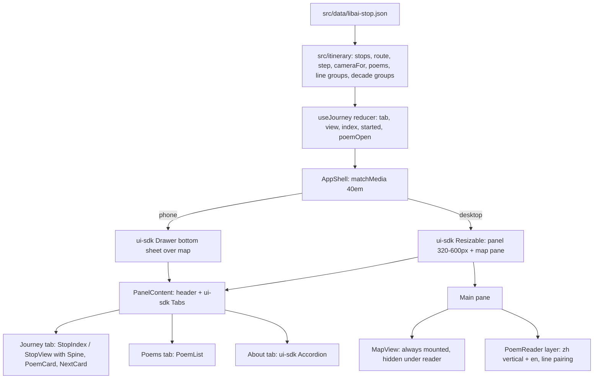
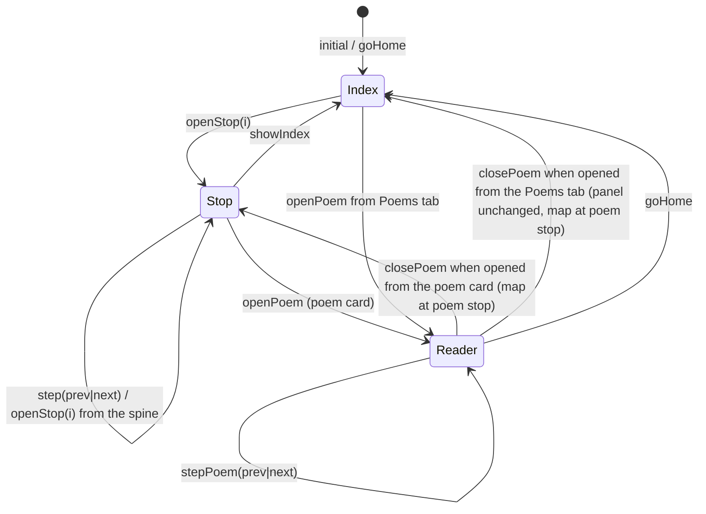

# Direction B Redesign - Plan

## Goal Capsule

- **Objective:** A reader of *The Banished Immortal* can see the whole journey at a glance, jump to any stop or poem, and read each of Li Bai's poems in Chinese beside Ha Jin's translation. This works on desktop and on a phone, in a quieter dark interface where orange marks only where the reader is.
- **Means:** Rebuild the panel and add a poem reader in the existing Vite + React 19 app, using ui-sdk Tabs, Accordion, Resizable, Drawer, Toolbar and Scroll Area (KTD1–KTD6). Match the approved canvas design.
- **Authority:** Product Contract requirements win on behavior. KTDs win on mechanism. The canvas frames are the visual reference: `Main.dc.html` for desktop copy, tokens and interaction, and the four `Mobile*.dc.html` frames for phone states. They sit under `/private/tmp/claude-501/-Users-kohzy-Documents-GitHub-libai-map/e7c0367a-7443-4f6c-916b-a2843d3a7288/scratchpad/libai-canvas/project/` and on the canvas https://claude.ai/artifact/AmD5PrvWW8yKmQboHAuGx2.
- **Execution profile:** One PR, the existing PR #3 on `refactor/vite-react19-ui-sdk`. New commits go on top, one per unit, in order U1 → U9.
- **Stop conditions:**
  - Stop if a ui-sdk component cannot do what a settled decision needs (for example, Drawer cannot stay open without dismissal).
  - Stop if mapbox-gl 1.x cannot fit the whole route, or keep its state while the reader covers it.
  - Do not deploy to Vercel production in this run.
- **Who finishes:** `ce-work` implements. The calling `lfg` run reviews, ships and watches PR #3.

---

## Product Contract

### Summary

Replace the single-purpose side panel with a three-tab panel: Journey (stop index and stop view with a progress spine), Poems (all 16 poems) and About (accordion). Add a poem reader that takes over the map area, sets the Chinese vertically beside the English, and links lines across the two languages. Retheme to a matte charcoal palette with new type, make the panel resizable on desktop, and turn it into a bottom sheet on phones.

### Problem Frame

The migrated app reproduces the 2020 Gatsby layout. A tall navy header carries a book-page number readers don't use. The only navigation is Prev/Next through 39 stops. Poems sit in the narrow panel as plain text, so the 16 poems, the most valuable content, are hard to read and impossible to browse. On phones the panel takes the full width and hides the map.

The owner reviewed three directions, chose direction B, and refined it over several rounds on the canvas. This plan builds that design.

### Requirements

**Look**

- R1. Palette: map `#161719`, panel `#1E1F22`, raised `#2A2C30`, hairline `#2E3034`, text `#E9E5DE`, secondary `#A8A59F`, graphite `#4A4D52`. Orange `#F38200` marks only the current position: the current stop, active segment, selected tab, open poem and highlighted line pair.
- R2. Type: Newsreader for titles and translations, Instrument Sans for interface text, Noto Serif SC for Chinese.

**Panel**

- R3. The header shows the site title and the line "Li Bai, 701 to 762, from Ha Jin's *The Banished Immortal*". There is no book-page tracker. Activating the title returns to the start of the journey: Journey tab, stop index, whole-route map, reader closed, no current stop.
- R4. The panel has Journey / Poems / About tabs. They sit flush left, a sliding orange indicator sits under the selected label, and panels slide in the direction of travel. Reduced motion turns the movement off.
- R5. Journey tab, index view:
  - All 39 stops, grouped by decade.
  - Each row shows the year, title, age (year − 701) and a ring marker when the stop has a poem.
  - There is no Begin/Continue button.
  - The last-opened stop is highlighted with an orange dot.
- R6. Journey tab, stop view:
  - An "All stops" back button.
  - "Stop N of 39" and previous/next buttons, keeping the current stepping rules.
  - A clickable 39-tick progress spine: current tick orange, visited ticks light, ticks with a poem taller.
  - Year and "Li Bai is N", the title, then Then / Now / With.
  - When the stop has a poem, a poem card (English title, Chinese title, "Read the poem").
  - A next-stop card at the bottom.
- R7. Poems tab: the 16 poems in journey order. Each row shows the English title, the Chinese title, and an info line in the form "726 in Yangzhou, stop 14, age 25". Choosing one opens the reader and makes that stop current.
- R8. About tab: an accordion of The book, Who made it and Colophon, with copy from the canvas. One section is open at a time, starting with The book. Who made it keeps the placeholder bio line until the owner supplies one.
- R9. On desktop the panel resizes between 320 and 600px, starting at 380px. It resizes by drag or keyboard, and double-click resets it.

**Poem reader**

- R10. The reader replaces the map in the main area. Close brings the map back at that poem's stop. The top bar has only previous poem, next poem and Close.
- R11. At desktop width the Chinese poem sits on the left and the English on the right, with no wrapping. Font sizes are fixed: Chinese 30px set vertically and read right to left, English 20px.
  - The Chinese column shows the orange Chinese title plus the first four lines and scrolls left for the rest.
  - A "Scroll left for N more lines" hint appears when there are more than four lines.
  - The English title is orange and smaller than the translation, followed by the lines and "Translated by Ha Jin".
  - There is no "From stop…" line and no "Show this stop on the map" link.
- R12. Line pairing:
  - Hovering a line in either language highlights its paired lines in both languages in orange and dims the rest.
  - Pairs are one to one, except stops 4, 28, 29 and 33, which use the hand-paired groups from the canvas.
  - Hovering an English line scrolls its Chinese partner into view.
  - Pairing also works by keyboard focus and by tap.

**Phones**

- R13. Below 40em the map fills the screen. The panel is a bottom sheet with the same header, tabs and content. The reader is full screen, with the Chinese (26px) stacked above the English.

**Unchanged behavior**

- R14. Everything below still works:
  - Stepping rules.
  - Map camera fallbacks (zoom 10, bearing 30, pitch 0).
  - Steps taken before the map loads apply once it loads.
  - The missing-token message.
  - The error boundary around the lazily loaded map.
  - The existing Vitest suite.

### Key Decisions

- **Direction B layout.** (session-settled: user-directed, chosen over A, a list-only home, and C, a bottom timeline scrubber: overview plus position without changing pages.) Governs R5, R6.
- **Matte charcoal palette, orange only for position.** (session-settled: user-directed, chosen over the original navy/teal and the lighter `#202124` charcoal: a cleaner, darker matte look.) Governs R1.
- **Remove the page tracker.** (session-settled: user-directed, chosen over keeping it: no reader value.) Governs R3.
- **Remove Begin/Continue.** (session-settled: user-directed, chosen over a start call to action: the rows already open stops.) Governs R5.
- **Flush-left Journey/Poems/About tabs with sliding indicator and direction-aware panels.** (session-settled: user-directed, chosen over an About link to a separate view and over equal-width justified tabs.) Governs R4.
- **About as a single-open accordion.** (session-settled: user-directed, chosen over a plain prose page.) Governs R8.
- **Poem reader replaces the map.** (session-settled: user-directed, chosen over the full poem inline in the panel: room for the poem.) Governs R6, R10.
- **Poems tab with the date in the info line.** (session-settled: user-directed, chosen over a year column.) Governs R7.
- **Fixed two-column reader with a four-line Chinese window.** (session-settled: user-directed, chosen over adaptive font size and wrapping at desktop: consistency.) Governs R11.
- **Orange, smaller English poem title.** (session-settled: user-directed, chosen over a large white heading: it mirrors the Chinese title.) Governs R11.
- **Reader without context line, map link or counter.** (session-settled: user-directed, chosen over keeping them: the owner removed them on the canvas.) Governs R10, R11.
- **Cross-language line pairing.** (session-settled: user-directed, chosen over no pairing: it lets readers compare the languages.) Governs R12.
- **Resizable panel, 320–600px.** (session-settled: user-directed, chosen over a fixed width.) Governs R9.
- **Phone layout mirrors desktop.** (session-settled: user-directed, chosen over the earlier sheet with the poem inline: the same UX as desktop.) Governs R13.

### Scope Boundaries

- No changes to the stop data, the Mapbox style URL, the map's layer geometry or the deploy configuration.
- Photos stay as they are: a stop thumbnail shows when present, under the title in the stop view (the canvas left photos out only because it could not load them).
- No production deploy in this run.
- **Considered, not built:** persisting the panel width or tab across visits. Nothing asked for it, and Resizable's storage can add it later in a few lines.
- **Considered, not built:** URL routing for stops and poems. It is useful for sharing, but nothing asked for it, and it touches every navigation path.

#### Deferred to Follow-Up Work

- Replace the "Who made it" placeholder bio once the owner supplies one.
- The mapbox-gl v3 upgrade, still deferred from the migration plan.

### Sources

- Design: the canvas https://claude.ai/artifact/AmD5PrvWW8yKmQboHAuGx2.
  - `Main.dc.html` holds the tokens, copy, and the `LINE_GROUPS`, `TAB_DEFS`, poem list and decade-grouping logic in its script block.
  - `Mobile*.dc.html` hold the phone states.
- ui-sdk docs, in `node_modules/@ui-sdk/react/docs/components/`:
  - `tabs.md`: `TabsIndicator` exposes `--active-tab-left` and `--active-tab-width`. Panels get `data-starting-style`, `data-ending-style` and `data-activation-direction` for direction-aware animation, and stack in one grid cell.
  - `accordion.md`: single open by default, `defaultValue`.
  - `resizable.md`: pixel `defaultSize`, `minSize` and `maxSize`. The handle has keyboard support.
  - `drawer.md`: snap points, `modalAbove`, Not Dismissible, a bottom sheet over a usable page.
  - `toolbar.md` and `scroll-area.md`.
- Repo: `src/App.tsx`, `src/components/{SidePanel,PanelHeader,StepControls,StopDetails,MapView}`, `src/itinerary/index.ts`, `src/index.css`, `src/main.tsx`.
- Fonts: `@fontsource/newsreader` 5.3.0, `@fontsource/instrument-sans` 5.3.0 and `@fontsource/noto-serif-sc` 5.3.1. All split by unicode range, so a page downloads only the subsets it uses.

---

## Planning Contract

### Key Technical Decisions

- KTD1. **One reducer owns navigation state.** A `useJourney` hook wraps a pure reducer over `{ tab, view: 'index'|'stop', index, started, poemOpen }`. Its actions are `openStop`, `step`, `showIndex`, `selectTab`, `openPoem`, `stepPoem`, `closePoem` and `goHome`. Today the step function in `src/itinerary` already returns the next index, and the tab, view and reader rules are now complex enough to need tests. A pure reducer keeps them testable without React. Hover pairing stays local to the reader component.
- KTD2. **Tabs: ui-sdk `Tabs` with `TabsIndicator`, controlled by the reducer.** The indicator's CSS variables replace the canvas's hand measurement, inset so the underline matches the label width. Panels stack in one grid cell and animate from `data-activation-direction` under `prefers-reduced-motion: no-preference` (R4, settled tabs decision).
- KTD3. **Desktop panel: ui-sdk `Resizable` with `ResizablePanel` sized in px.** The panel is `defaultSize="380px"`, `minSize="320px"`, `maxSize="600px"`, with the map pane filling the rest. `ResizableHandle` provides the keyboard support. Double-click reset is a small handler on the handle that calls the group controller (R9). This resolves the open question of Resizable versus a custom handle: Resizable supports px bounds and keyboard, so no custom handle.
- KTD4. **Phones: ui-sdk `Drawer` as a persistent, non-dismissible bottom sheet.** It uses `snapPoints` (about 0.35, 0.65 and 0.92 of the viewport), `defaultSnapPoint` 0.65 (nearest the Journey frame), `modalAbove` at the lowest point (0.35) so the map is usable only under the small sheet, and a decorative handle bar. The Drawer renders in the browser top layer, so no in-page layer can sit above it. While the reader is open, a Drawer controller closes the sheet (controllers can close a non-dismissible drawer) and remembers its snap point. On `closePoem` it reopens at that point, with content kept mounted. A matchMedia hook at 40em picks Resizable or Drawer; both render the same `PanelContent` (R13). This resolves the open question: Drawer's documented "Not Dismissible" and `modalAbove` options cover a persistent sheet.
- KTD5. **The reader is a sibling layer over the map; the map is not unmounted.** `MapView` stays mounted and is hidden while the reader is open. Recreating a mapbox-gl map costs a style and tile reload and would lose the load-replay state. On close the map is already at the poem's stop, because `openPoem` and `stepPoem` set `index` (R10, R14).
- KTD6. **Line pairing data lives in the itinerary module.** `LINE_GROUPS` for stops 4, 28, 29 and 33 move into `src/itinerary/poems.ts`, along with `groupOf(stop, lang, line)` and `linesOf(stop, lang, group)`. The data is static and must stay in sync with `libai-stop.json`, so it sits beside it with tests (R12). Each line is a focusable element: hover, focus and tap set the group, and blur or pointer-leave clears it. Scrolling the Chinese partner into view uses `scrollIntoView({ inline: 'nearest' })`, and becomes instant under reduced motion.
- KTD7. **Whole-route map when no stop is current.** With `started` false, MapView fits the bounds of all 39 stops with no active segment. With `started` true, it eases to the current stop as today. Today's map always centres on stop 0, so `goHome` and the index view need this new camera mode (R3, R5). The camera fallbacks are unchanged.
- KTD8. **Theme tokens as CSS custom properties in `src/index.css`, shared by ui-sdk's tokens.** The `--ui-*` tokens map onto the palette (`--ui-background` to panel, `--ui-foreground` to text, `--ui-ring` to orange) so ui-sdk parts inherit the look. `color-scheme: dark` stays (R1). Lato is replaced by the three @fontsource families (R2).

### High-Level Technical Design





### Output Structure

```text
src/
  journey/useJourney.ts, journey/reducer.ts, journey/reducer.test.ts
  itinerary/poems.ts, itinerary/poems.test.ts
  hooks/useMediaQuery.ts
  components/
    AppShell/        desktop Resizable or mobile Drawer
    PanelContent/    header + Tabs
    JourneyTab/      StopIndex, StopView, Spine, PoemCard, NextCard
    PoemsTab/
    AboutTab/
    PoemReader/      PoemReader.tsx, PoemReader.test.tsx
    MapView/         (updated: whole-route mode, hidden state)
```

Removed: `SidePanel`, `PanelHeader`, `StepControls` and `StopDetails`, replaced by the above. Their tests move to the new components.

---

## Implementation Units

### U1. Theme tokens and type

- **Goal:** the palette and fonts are in place app-wide, and ui-sdk parts pick them up.
- **Requirements:** R1, R2 (KTD8)
- **Dependencies:** none
- **Files:** `src/index.css`, `src/main.tsx`, `package.json`, `package-lock.json`
- **Approach:**
  1. Replace the old custom properties with the tokens from R1. Map ui-sdk `--ui-*` tokens onto them and keep `color-scheme: dark`.
  2. Swap `@fontsource/lato` for `@fontsource/newsreader` (400, 500, plus italic 400), `@fontsource/instrument-sans` (400, 500, 600) and `@fontsource/noto-serif-sc` (400, 500). Set Instrument Sans as the base font.
- **Patterns to follow:** current `src/index.css`, and the `<helmet>` styles in `Main.dc.html`.
- **Test scenarios:** Test expectation: none -- styling only; verified in the browser pass.
- **Verification:** the build passes, and the app renders in the new palette and fonts.

### U2. Poem and grouping data

- **Goal:** the itinerary module provides poems, line pairing and decade groups as pure functions.
- **Requirements:** R5, R7, R12 (KTD6)
- **Dependencies:** none
- **Files:** `src/itinerary/poems.ts`, `src/itinerary/poems.test.ts`, `src/itinerary/index.ts`
- **Approach:**
  - Add `poemStops()` (indices of stops with a poem) and `placeName(stop)` (the historic name before " (").
  - Add `poemInfo(stop)`, which builds "726 in Yangzhou, stop 14, age 25", and `decadeGroups()`.
  - Port `LINE_GROUPS` from `Main.dc.html` exactly, with `groupOf(stop, lang, line)` and `linesOf(stop, lang, group)`.
  - Export `age(stop)` as year − 701.
- **Test scenarios:**
  - `poemStops()` returns 16 indices, starting at stop 4 (index 3) and ending at stop 39 (index 38).
  - `poemInfo` for stop 14 returns "726 in Yangzhou, stop 14, age 25".
  - `decadeGroups()` returns labels 700s through 760s in order, and the group counts sum to 39.
  - For every poem without hand groups, Chinese and English line counts are equal, and `groupOf` is the identity.
  - For stops 4, 28, 29 and 33: the Chinese and English group arrays match their line counts, every group id in one language exists in the other, and stop 33's Chinese lines 0 and 1 share group 0 with English line 0.
- **Verification:** `npm test` passes, including the data-consistency checks against `libai-stop.json`.

### U3. Navigation reducer

- **Goal:** all panel, tab and reader navigation runs through one tested reducer.
- **Requirements:** R3, R5, R6, R7, R10, R14 (KTD1)
- **Dependencies:** U2
- **Files:** `src/journey/reducer.ts`, `src/journey/reducer.test.ts`, `src/journey/useJourney.ts`
- **Approach:**
  - State is `{ tab, view, index, started, poemOpen }`, starting at journey / index / 0 / false / false.
  - `step` reuses the existing itinerary `step`.
  - `openPoem(i)` sets `index = i`, `started` and `poemOpen`. `stepPoem` cycles through `poemStops()`.
  - `closePoem` keeps `index` and returns to the map.
  - `openStop` and `step` close the reader.
  - `goHome` resets to the initial state with the Journey tab.
  - `selectTab` sets `tab`. The slide direction comes from ui-sdk's `data-activation-direction` (KTD2), not from reducer state.
  - `closePoem` leaves the panel tab and view as they were. The diagram's two close edges are that same rule seen from the two openers.
- **Test scenarios:**
  - Initial state is the Journey tab, index view, nothing started, reader closed.
  - `openStop(13)` gives the stop view at index 13, started.
  - `step('next')` from 38 wraps to 0, and `step('prev')` at 0 stays at 0.
  - `openPoem(13)` from the Poems tab sets index 13 and opens the reader, without changing the tab.
  - `stepPoem('next')` from the last poem (index 38) wraps to the first poem stop (index 3), and `stepPoem('prev')` from index 3 wraps to 38.
  - `closePoem` keeps index and tab and closes the reader.
  - `openStop` while the reader is open closes it.
  - `goHome` from Poems with the reader open returns to the initial state.
- **Verification:** reducer tests pass, and the existing itinerary tests are unchanged.

### U4. Desktop shell: Resizable panel, header, Tabs

- **Goal:** the desktop layout shows a resizable panel with the home title and working tabs.
- **Requirements:** R3, R4, R9 (KTD2, KTD3)
- **Dependencies:** U1, U3
- **Files:** `src/App.tsx`, `src/App.module.css`, `src/components/AppShell/*`, `src/components/PanelContent/*`, `src/components/PanelContent/PanelContent.test.tsx`, `src/hooks/useMediaQuery.ts`. Delete: `src/components/SidePanel/`, `src/components/PanelHeader/`.
- **Approach:**
  - Use ui-sdk `Resizable` with px sizes (KTD3), with a double-click reset on the handle. Its look follows the canvas: hairline that turns orange on hover or drag, with a centre knob.
  - The header title is a button that dispatches `goHome`.
  - Tabs are controlled by `state.tab`. `TabsIndicator` is styled from its CSS variables with a 14px inset. Panels slide in from `data-activation-direction` and stack in one grid cell, with no motion under reduced motion.
  - Read `node_modules/@ui-sdk/react/docs/components/{tabs,resizable}.md` first (per AGENTS.md).
- **Patterns to follow:** the `TAB_DEFS` and tab-list markup in `Main.dc.html`, and the ui-sdk Tabs Animation and Indicator examples.
- **Test scenarios (Vitest + Testing Library):**
  - The tablist is named and lists Journey, Poems and About in order, with Journey selected first.
  - Clicking Poems selects it and shows the Poems panel. ArrowRight from Journey moves selection to Poems.
  - Clicking the title after opening a stop and switching to About returns to Journey with the stop index visible.
  - The resize handle has an accessible name, and ArrowRight increases the panel size. Assert through the handle's `aria-valuenow`, or skip if jsdom cannot lay out, with a note.
- **Verification:** component tests pass. In the browser, dragging stays within 320–600px and double-click resets to 380px.

### U5. Journey tab

- **Goal:** the stop index and stop view match the canvas.
- **Requirements:** R5, R6, R14
- **Dependencies:** U2, U3, U4
- **Files:** `src/components/JourneyTab/{StopIndex,StopView,Spine,PoemCard,NextCard}.tsx` and their CSS modules, `src/components/JourneyTab/JourneyTab.test.tsx`. Delete: `src/components/StopDetails/`. Move the toolbar into StopView, keeping ui-sdk `Toolbar` for previous/next and carrying over the `StepControls` test cases.
- **Approach:**
  - **Index:** decade sections, each holding an ordered list of row buttons (year, title, "Age N", and ", with a poem" for poem stops). A ring marker shows for poem stops and an orange dot on the current stop once started.
  - **Stop view:**
    - "All stops" back button, "Stop N of 39" and a ui-sdk Toolbar with previous and next.
    - The spine as a group of 39 buttons with one tab stop: roving tabindex, with ArrowLeft, ArrowRight, Home and End moving and activating, like a Toolbar. Each tick has an accessible name ("Stop 14: Sick and Destitute in Yangzhou") and a 22px-tall hit area.
    - Header with year and "Li Bai is N", then the title.
    - The thumbnail, when present.
    - Then / Now / With as a description list.
    - PoemCard when the stop has a poem, then NextCard.
  - Content scrolls inside ui-sdk Scroll Area, with the native scrollbar hidden as today.
- **Test scenarios:**
  - Index renders 7 decade headings and 39 row buttons. The stop 4 row has the poem marker and stop 1's does not.
  - Clicking the stop 14 row shows "Stop 14 of 39", the title "Sick and Destitute in Yangzhou" and a "Read the poem" button.
  - Stop 17 (no companions) has no With row. Stop 7 (no thumbnail) shows no image.
  - The spine has 39 named buttons, and clicking "Stop 20" shows stop 20. Tab reaches the spine once, and ArrowRight from the current tick opens the next stop.
  - Previous and next toolbar wiring follows the old StepControls tests: one tab stop, arrow keys move focus, Enter on Next steps forward.
  - "All stops" returns to the index with the stop 14 row marked current.
- **Verification:** tests pass, and the browser check matches the canvas.

### U6. Poems and About tabs

- **Goal:** both tabs work as designed.
- **Requirements:** R7, R8
- **Dependencies:** U2, U3, U4
- **Files:** `src/components/PoemsTab/*`, `src/components/AboutTab/*`, and tests in each.
- **Approach:**
  - **Poems:** an intro line, then a list of buttons (English title, Chinese title with `lang="zh-Hans"`, and the `poemInfo` line) that dispatch `openPoem`. The open poem's row is marked.
  - **About:** ui-sdk Accordion (single open, `defaultValue={["book"]}`) with the copy from `Main.dc.html`, including the GitHub link and the colophon list. Read `accordion.md` first.
- **Test scenarios:**
  - The Poems tab lists 16 rows. The fifth row reads "Reflection in a Quiet Night", "静夜思" and "726 in Yangzhou, stop 14, age 25".
  - Clicking that row opens the reader on 静夜思.
  - About opens with The book expanded and the others collapsed. Opening Colophon collapses The book.
- **Verification:** tests pass.

### U7. Poem reader

- **Goal:** a readable two-language poem view with line pairing replaces the map on demand.
- **Requirements:** R10, R11, R12 (KTD5, KTD6)
- **Dependencies:** U2, U3, U4
- **Files:** `src/components/PoemReader/PoemReader.tsx`, `src/components/PoemReader/PoemReader.module.css`, `src/components/PoemReader/PoemReader.test.tsx`, `src/App.tsx`
- **Approach:**
  - **Layout:** a layer over the main pane with a top bar (previous poem, next poem, a spacer, then "Close") and a centred non-wrapping row: Chinese column, then English column.
  - **Chinese column:**
    - A focusable, horizontally scrollable `writing-mode: vertical-rl` block, 30px, width 8.75em, with the orange title as the first column.
    - Its initial scroll position shows the first lines at the right.
    - The "Scroll left for N more lines" hint shows when there are more than four lines.
  - **English column:** orange 16px Newsreader title, 20px lines and "Translated by Ha Jin".
  - **Line pairing:** each line is a focusable element. Pointer enter, focus or tap sets the group from `groupOf`. Matching lines in both languages get the orange-on-tint style, and the others dim. An English line also scrolls its Chinese partner into view, instantly under reduced motion.
    - Precedence: pointer hover wins while the pointer is over a line. Otherwise the focused line's group shows.
    - A tap toggles its group, and a tap outside the poem clears it, since touch fires no pointer-leave.
  - **Narrow main pane:** the reader is a CSS container (`container-type: inline-size`). Below about 760px of reader width it uses the stacked layout (Chinese 26px above English 18px), the same one phones use. The 40em media query decides only Drawer versus Resizable (U9). Example: a 1024px window with the panel at 600px.
  - **Focus:**
    - On open, focus moves to the reader's first top-bar button.
    - Close and Escape return focus to the element that opened the reader (poem card or Poems row).
    - On phones, focus returns once the Drawer reopens.
  - **Map:** MapView stays mounted and hidden.
- **Test scenarios:**
  - Opening stop 14's poem renders 静夜思 and "Reflection in a Quiet Night", with no counter, context line or map link.
  - Stop 4 (exactly four Chinese lines) shows no scroll hint. Stop 15 (8 lines) shows "Scroll left for 4 more lines".
  - Hovering English line 2 of stop 15 marks Chinese line 2 and English line 2 as paired (via a data attribute such as `data-paired`), and the other lines dimmed.
  - Stop 33: focusing English line 0 pairs Chinese lines 0 and 1. Stop 28: hovering Chinese line 1 pairs English lines 1–3.
  - Next poem from stop 14 goes to stop 15, and previous from stop 4 goes to stop 39.
  - Close hides the reader and shows the map container. Assert MapView is the same element instance, not remounted.
  - Opening from the stop 14 poem card moves focus into the reader. Escape closes it and returns focus to the poem card.
  - With the reader container narrower than 760px (stub the container query, or assert the class driven by a ResizeObserver), the Chinese column renders above the English.
- **Verification:** tests pass. In the browser, the four-line window, scroll left and pairing work on stops 4, 15, 28 and 33.

### U8. Map modes

- **Goal:** the map shows the whole route when no stop is current, and keeps its behavior otherwise.
- **Requirements:** R3, R5, R14 (KTD7)
- **Dependencies:** U3
- **Files:** `src/components/MapView/MapView.tsx`, `src/itinerary/index.ts` (route bounds), `src/itinerary/index.test.ts`
- **Approach:**
  - Add `routeBounds()` to the itinerary module.
  - MapView takes `started`. When false, it `fitBounds`es the route with padding (or `jumpTo` before load), and the active segment source is empty. When true, it behaves as today.
  - Restyle the route, visited and active layer colors to the palette: graphite, light grey and orange.
  - Keep the load-time replay, so a `goHome` or step before load applies once the map loads. `latestRef` holds `started` with the stop and segment, and the load handler reapplies the camera when either the stop or `started` differs from the values the map was created with.
  - A ResizeObserver on the map wrapper calls `map.resize()` whenever its size changes, and disconnects in cleanup. mapbox-gl 1.13 only tracks window resizes, so this covers panel drag, keyboard resize, double-click reset and the reader hiding and showing the map.
- **Test scenarios:**
  - `routeBounds()` covers stop 1 (Suyab, the western extreme) and stop 21 (Hangzhou, the eastern extreme).
  - Existing `cameraFor` tests are unchanged.
- **Verification:** tests pass. In the browser with a real token, the initial view and "home" show all 39 stops, and opening a stop eases in as before.

### U9. Phone layout

- **Goal:** phones get the bottom sheet and the full-screen stacked reader.
- **Requirements:** R13 (KTD4)
- **Dependencies:** U4, U5, U6, U7
- **Files:** `src/components/AppShell/MobileShell.tsx`, `src/components/AppShell/AppShell.module.css`, `src/components/PoemReader/PoemReader.module.css`, `src/components/AppShell/AppShell.test.tsx`
- **Approach:**
  - Below 40em, AppShell renders the map full screen and a ui-sdk Drawer per KTD4. The Drawer holds the same `PanelContent`. Read `drawer.md` (Snap Points, Modal, Not Dismissible, Controlled, Controller) first.
  - While `poemOpen`, the Drawer is closed through its controller and the reader fills the screen over the map, stacking Chinese (26px) above English (U7's narrow layout). Close reopens the Drawer at the remembered snap point.
  - Tap pairing comes from U7's focus and tap handling.
- **Test scenarios:**
  - With a matchMedia stub at 390px wide, AppShell renders a Drawer containing the tablist and no Resizable handle. At 1280px it renders the Resizable handle and no Drawer.
  - On the phone layout, opening a poem from the Poems tab closes the Drawer and shows the reader's Close button as clickable. Close reopens the Drawer with the Poems tab still selected.
  - Tapping a Chinese line in the reader marks its English pair.
- **Verification:** tests pass. A browser check at 390×844 matches the four mobile canvas frames.

---

## Risks & Dependencies

| Risk | Mitigation |
|---|---|
| ui-sdk beta (0.1.0-beta.17) Tabs, Drawer or Resizable behave differently from their docs | Follow the shipped docs and the ui-sdk skill. If a component blocks a settled behavior, stop (Goal Capsule) rather than hand-roll the role. |
| Hiding the mapbox canvas (`display: none`) breaks its size on return | Hide with `visibility: hidden`, or call `map.resize()` on close. Verify in the browser. |
| Noto Serif SC weight | The @fontsource unicode-range subsets load only the glyphs used. Check the network total in the browser pass. |
| Mobile Drawer snap behavior on touch versus mouse (`driver: auto`) | Check in the browser at phone size. Pointer behavior on desktop is out of scope. |

---

## Verification Contract

| Gate | Check | Applies to |
|---|---|---|
| Type check and build | `npm run build` | every unit |
| Tests | `npm test` | U2–U9 |
| Lint | `npm run lint` | final |
| Browser, desktop 1280×800 with a real token in `.env.local` | Tabs and indicator, index, stop view and spine, poem card, reader (stops 4, 14, 15, 28, 33), pairing hover, scroll left, Close back to the map, title home, resize drag and keyboard with the map filling its pane afterwards, the stacked reader layout with the panel at 600px in a 1024px window, About accordion, no console errors | U4–U8, final |
| Browser, phone 390×844 | Sheet snap points, the tabs inside the sheet, full-screen stacked reader, tap pairing | U9, final |

---

## Definition of Done

- R1–R14 hold, checked by the unit verifications.
- `npm run build`, `npm test` and `npm run lint` pass.
- The desktop and phone browser checks match the canvas frames, with a clean console.
- The old `SidePanel`, `PanelHeader`, `StepControls` and `StopDetails` components and Lato are removed, with no dead code left from abandoned attempts.
- The commits are on `refactor/vite-react19-ui-sdk` (PR #3). Nothing is deployed to production.

## Assumptions

- The header title resetting to the start of the journey (index view, whole route) is a directive the owner did not object to; it is not a confirmed decision.
- Mobile Drawer snap points (0.35, 0.65 and 0.92) are not on the canvas. They are chosen so the map stays visible at the lowest point.
- The poem card on mobile drops the "Poem from this stop" label, matching the owner's desktop edit.

---

## Deferred / Open Questions

These are review items left for the author. They do not block implementation.

### From 2026-11-27 review

- **Phone sheet header: title only, or with the subtitle line?** — R13 Phones (P2, design-lens, confidence 75)

  R13 says the sheet has "the same header" as desktop, which includes the "Li Bai, 701 to 762…" line, but all three phone sheet frames show only the title. Until the owner says otherwise, the implementation follows the frames (title only), since the Definition of Done checks against them.

- **Orange beyond "current position": resize handle and focus rings** — R1 Palette (P2, coherence, confidence 75)

  The canvas turns the resize handle orange on hover or drag, and orange focus rings are kept for keyboard visibility. R1's list of orange uses doesn't name either. The implementation keeps both as on the canvas. Confirm, or name a different hover color for the handle.

  Change: add "the resize handle while hovered or dragged" to R1's orange list, and note focus rings as an accessibility exception.
