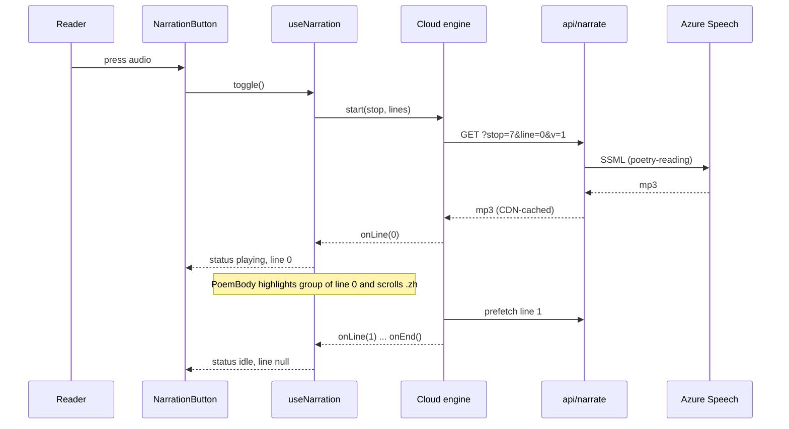
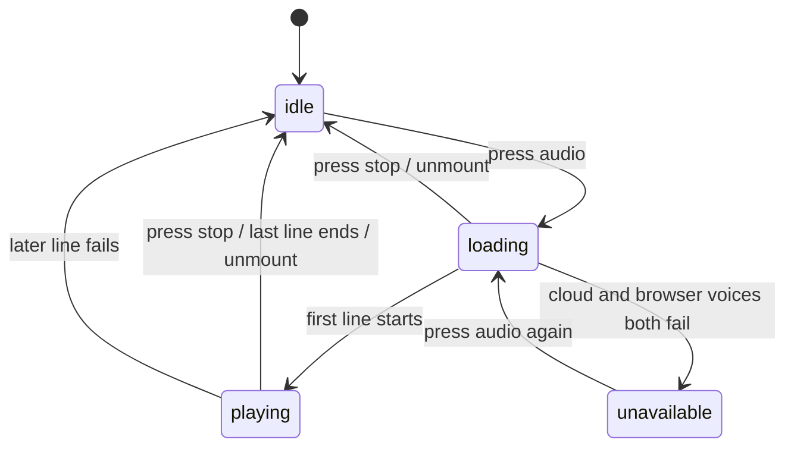

# Poem Audio Narration - Plan

## Goal Capsule

- **Objective:** A reader in the poem reader can press one button below the Chinese poem to hear it read aloud in expressive Mandarin, follow each line as it lights up, and stop at any time.
- **Means:** A Vercel Function synthesizes each Chinese line on demand with Azure AI Speech (`poetry-reading` style), and its responses are cached at the CDN. The client plays the lines in order and drives the existing hover highlight and the Chinese column's horizontal scroll (KTD1–KTD5). If the cloud voice is unavailable, the browser's own speech synthesis reads the poem instead (KTD3).
- **Authority:** The Requirements below win on behavior. KTDs win on mechanism. The existing hover highlight styles (`data-paired` / `data-dimmed` in `src/components/PoemReader/PoemReader.module.css`) are the visual reference for narrated lines.
- **Execution profile:** One PR on the current branch `refactor/vite-react19-ui-sdk`, units in order U1 → U5.
- **Stop conditions:**
  - Stop if Vercel's Vite preset cannot serve a TypeScript function from `api/` next to the static build.
  - Do not commit any Azure key, and do not deploy to Vercel production in this run.
- **Who finishes:** `ce-work` implements. The calling `lfg` run reviews, ships and watches the PR. The owner adds `AZURE_SPEECH_KEY` and `AZURE_SPEECH_REGION` to the Vercel project to switch on the neural voice.

---

## Product Contract

### Summary

Add a narration control below the Chinese poem in the poem reader. Pressing it reads the poem line by line in a Mandarin voice tuned for poetry. Each line gets the hover highlight in both languages while it is spoken, and the vertical Chinese column scrolls sideways to keep the spoken line in view. Pressing it again stops narration and clears the highlight.

### Problem Frame

The reader already pairs Chinese and English lines on hover, but many readers of Ha Jin's book cannot read or pronounce classical Chinese. They see the characters and never hear the sound of the poem. Tang poetry is meant to be heard, with its rhyme and its tonal patterns. Hearing it with the line pairing in place lets a reader match the sounds to the characters and to Ha Jin's translation.

### Requirements

**Control**

- R1. Below the Chinese poem (under the "Scroll left" hint when it shows) sits an audio button. Pressing it starts narration from the first line.
- R2. While narration is loading or playing, the same button becomes a stop button. Pressing it stops the audio at once and returns the control to the audio button.
- R3. Narration ends by itself after the last line. The control then returns to the audio button and the highlight clears.
- R4. Closing the reader, pressing Escape, or moving to the previous or next poem stops narration.

**Highlight and scroll**

- R5. The line being spoken shows the same highlight as hover: its group is `data-paired` in both languages and other lines are `data-dimmed`. Hand-paired poems (stops 4, 28, 29 and 33) highlight by group, as hover does.
- R6. When the spoken line is outside the visible part of the Chinese column, the column scrolls sideways to bring it into view. Smooth scrolling turns off under reduced motion, and the outer reader does not scroll up or down because of narration.
- R7. A pointer hover or keyboard focus on a line takes precedence over the narration highlight while it lasts. Narration resumes showing once the pointer leaves.

**Voice and availability**

- R8. The voice is an expressive Mandarin voice reading at a measured pace, with a pause between lines.
- R9. When the cloud voice cannot be reached, narration falls back to a Chinese voice built into the browser. When neither exists, the control says narration is unavailable and nothing plays.
- R10. Screen-reader users hear the button's current action, and a polite status announces when narration starts, stops, or is unavailable.

### Key Decisions

- **One button that toggles between audio and stop, not two buttons side by side.** Swapping in place keeps keyboard focus on the control. Two separate buttons would leave one disabled at all times. Governs R1, R2.
- **Hover and focus beat narration; tap does not.** A resting mouse would otherwise hide narration only while it rests, which is what hover means. Pressing play clears a tapped pairing so narration can show. Governs R7.

### Scope Boundaries

- Narration covers the Chinese poem only. The English translation is not read aloud.
- No pause/resume, seeking, speed control, or starting from a chosen line.
- No pinyin display or per-character karaoke highlight; highlighting is per line.
- Considered and not built: rate limiting on the narration endpoint. The handler accepts only the canonical URL for each of the 105 bundled lines (U2), and the CDN caches each one, so the most it can cost is 674 characters per cache fill. Abuse traffic in Vercel logs would change this call.
- Considered and not built: a browser token flow for the Azure Speech SDK (`/issueToken`). Per-line REST clips give line timing without the SDK.

### Deferred to Follow-Up Work

- Per-character pronunciation overrides (`<phoneme>`) for classical readings such as 斜 (xiá) once someone listens through all 16 poems.

---

## Planning Contract

### Key Technical Decisions

- KTD1. **On-demand synthesis through a Vercel Function, cached at the CDN.** `api/narrate.ts` accepts a stop number and a line index, looks the text up in `src/data/libai-stop.json`, and returns an MP3. Responses carry a long `s-maxage` and `immutable`, plus a voice-version query value so a voice change busts the cache. This keeps the Azure key server-side and makes the endpoint unable to speak arbitrary text. Both research passes recommended pre-generating static clips at build time instead. That is cheaper still, but the request asks for a real-time narration service; CDN caching gives most of the same benefit.
- KTD2. **Azure AI Speech `zh-CN-XiaoxiaoNeural` with `mstts:express-as style="poetry-reading"`.** Azure was the only provider found with a native poetry-reading style for Mandarin. SSML `<prosody rate>` slows the pace and a trailing `<break>` gives the pause between lines (R8). The REST endpoint `https://<region>.tts.speech.microsoft.com/cognitiveservices/v1` with `X-Microsoft-OutputFormat: audio-24khz-48kbitrate-mono-mp3` is enough. Voice name, style, rate and break length live in one constant module so a later audition can retune them. ElevenLabs (`with-timestamps`) is the second choice if Azure quality disappoints. OpenAI TTS and Google Chirp 3 HD were rejected: they have no poetry style or timing data, and there are reports of OpenAI ignoring its instructions.
- KTD3. **One clip per line, played in sequence through one audio element, with browser speech as the fallback engine.** Line timing then comes from which clip is playing, so no alignment data is needed. One `HTMLAudioElement` is created and `play()`ed synchronously inside the button's click handler, then its `src` is swapped for each later line. iOS Safari grants playback only to an element a user gesture started, so a new element per line would be blocked after line one. Line N+1 is warmed with `fetch` while line N plays. If the first clip fails (network error, or 503 when no key is set), the hook switches to a `speechSynthesis` engine that speaks one `zh-CN` utterance per line at a slower rate. It does this only when a `zh` voice exists. Chrome fills `getVoices()` lazily, so the check waits briefly for `voiceschanged` before concluding there is none. The click handler also primes `speechSynthesis` with an empty utterance so iOS allows the later fallback. A failure after the first line ends narration instead of switching voices midway.
- KTD4. **A small engine interface behind a `useNarration` hook.** Engines expose start and stop and report line changes, completion and errors through callbacks. Every callback is guarded by a run token, so late events from a stopped run (the speech queue is global) cannot move the highlight on a new poem. `useNarration` owns status (`idle`, `loading`, `playing`, `unavailable`) and the current Chinese line, and stops on unmount. Tests inject a fake engine, because jsdom has neither `HTMLMediaElement.play` nor `speechSynthesis`.
- KTD5. **Narration scrolls only the Chinese column, horizontally.** The existing `revealZh` uses `scrollIntoView`, which also scrolls the outer `.scroll` container. On phones that would pull the reader back up on every line. Narration sets the `.zh` element's horizontal scroll directly, and only when the line is out of view. The hover path keeps `revealZh` unchanged.
- KTD6. **Dev parity through a Vite dev-server middleware.** `vite.config.ts` mounts the same handler at `/api/narrate` during `npm run dev`, reading `AZURE_SPEECH_KEY` and `AZURE_SPEECH_REGION` with `loadEnv` (no `VITE_` prefix, so they never reach the client bundle). Without a key, dev falls back to browser speech, like production would.

### High-Level Technical Design

The highlight shown in `PoemBody` becomes `hover ?? focus ?? narration ?? tap`, where narration is the group of the current Chinese line (R5, R7).

### Assumptions

- The owner will create an Azure Speech resource and set `AZURE_SPEECH_KEY` and `AZURE_SPEECH_REGION` in Vercel. Until then the site uses browser speech, and this is visible in the PR body.
- Vercel's Vite framework preset serves functions from a root `api/` directory alongside `dist/`. The function uses the Web-standard `Request`/`Response` handler on the Node runtime.
- `XiaoxiaoNeural` with `poetry-reading` sounds good enough for the 16 poems. Microsoft's style lists disagree between pages, and Azure usually ignores an unsupported style rather than returning an error, so no code path detects a wrong style. The listening check in U5 is where that shows. The voice constant can be swapped after an audition in Speech Studio.
- Azure's terms allow caching the generated audio at a CDN for this use. This was not verified.

### Sources

- Provider comparison, Azure voice styles, SSML and output formats: web research dossier from this planning run (Azure Learn "Language and voice support", "Speech Synthesis Markup Language" pages; ElevenLabs "Create speech with timing").
- Existing hover pairing and scroll: `src/components/PoemReader/PoemReader.tsx` (`lineProps`, `revealZh`), `src/itinerary/poems.ts` (`groupOf`, `LINE_GROUPS`).
- Test harness: `src/test/setup.ts` stubs `scrollIntoView` and `matchMedia`, and `src/components/PoemReader/PoemReader.test.tsx` asserts the exact reader button list.

---

## Implementation Units

### U1. Narration request contract and SSML builder

- **Goal:** One shared module that turns (stop number, line index) into the Chinese text and the SSML to synthesize, and that both the function and the client use to build URLs.
- **Requirements:** R8; KTD1, KTD2.
- **Dependencies:** none.
- **Files:** `src/narration/voice.ts` (voice constants and voice version), `src/narration/request.ts` (line lookup, SSML builder, clip URL builder), `src/narration/request.test.ts`.
- **Approach:**
  1. Read `src/data/libai-stop.json` directly by relative path with a JSON import attribute, and map stop number n to `features[n - 1]`, which matches `stopNumber`. The server imports these modules, so `voice.ts` and `request.ts` must not use the `@/` alias, import `src/itinerary` (which pulls in the alias and turf), or use extensionless relative imports.
  2. Escape XML special characters in the line text before placing it in SSML.
  3. Build the clip URL as `/api/narrate?stop=<n>&line=<i>&v=<voice version>`.
- **Patterns to follow:** pure helpers with colocated tests, as in `src/itinerary/poems.ts` and `poems.test.ts`.
- **Test scenarios:**
  - Stop 4 (the first poem stop) line 0 returns its first Chinese line.
  - A stop without a poem, a negative line, a line past the end, and a non-integer input all return no text.
  - The SSML names the configured voice, wraps the text in `express-as` with `poetry-reading`, sets the prosody rate, and ends with the break.
  - A line containing `&` or `<` is escaped in the SSML.
  - The clip URL carries the voice version.
- **Verification:** the helpers return the right text for every poem stop and valid SSML for every line.

### U2. `api/narrate` Vercel Function and dev middleware

- **Goal:** A GET endpoint that returns an MP3 for one known poem line, cached at the CDN, plus the same handler in the Vite dev server.
- **Requirements:** R8, R9; KTD1, KTD2, KTD6.
- **Dependencies:** U1.
- **Files:** `api/narrate.ts`, `src/narration/handler.ts` (the framework-free handler: `Request` and env in, `Response` out), `src/narration/handler.test.ts`, `vite.config.ts`, `tsconfig.node.json` (include `api` and `src/narration`, with `resolveJsonModule`), `.env.example`, `README.md`.
- **Approach:**
  1. The handler accepts only the canonical URL. It returns 400 with `no-store`, without calling Azure, for an unknown line, for a `v` other than the current voice version, or for any query parameter besides `stop`, `line` and `v`. This keeps the CDN cache to one entry per line, which the Scope Boundaries cost bound depends on. `handler.ts` follows the same import rules as U1.
  2. Without `AZURE_SPEECH_KEY` or `AZURE_SPEECH_REGION` it returns 503, which the client treats as "use the fallback".
  3. It POSTs the SSML to Azure with the key header and MP3 output format. A non-2xx from Azure becomes 502, and the Azure body is logged but not returned.
  4. A success streams the audio with `Content-Type: audio/mpeg` and `Cache-Control: public, max-age=86400, s-maxage=31536000, immutable`. Errors are sent with `no-store`.
  5. `api/narrate.ts` only adapts the handler to Vercel's function export. The Vite plugin mounts the handler at `/api/narrate` in `configureServer` only.
  6. Document both env vars in `.env.example` and the README's Vercel section as server-only.
- **Patterns to follow:** env handling as documented in `README.md` "Deploying on Vercel".
- **Test scenarios:** (fetch mocked; this seam catches contract and caching mistakes, but not real Azure voice behavior)
  - A valid stop and line with env set calls the region's `cognitiveservices/v1` URL with the key header, output format header and SSML body, and returns 200 audio with the immutable cache header.
  - An unknown line returns 400 and never calls fetch.
  - A missing key returns 503 with `no-store` and never calls fetch.
  - Azure answering 401 or 429 returns 502 with `no-store`.
  - A stale or random `v` returns 400 with `no-store` and never calls fetch.
  - An extra query parameter (for example `text` or `x`) returns 400 and never calls fetch.
- **Verification:** `npm run build` type-checks the function. With a key in `.env.local`, `npm run dev` serves playable audio at `/api/narrate?stop=…&line=0`. On the PR's Vercel preview deployment (never production), `/api/narrate?stop=4&line=0&v=<current>` returns audio or 503, which proves the function loads under Vercel's Node ESM runtime.

### U3. Narration engines and `useNarration` hook

- **Goal:** Client-side playback that reports the current Chinese line, falls back to browser speech, and cleans up on stop and unmount.
- **Requirements:** R2, R3, R4, R9; KTD3, KTD4.
- **Dependencies:** U1.
- **Files:** `src/narration/engines.ts` (engine interface, cloud audio engine, speech engine, engine factory), `src/narration/useNarration.ts`, `src/narration/engines.test.ts`, `src/narration/useNarration.test.ts`.
- **Approach:**
  1. Cloud engine: one `Audio` element, unlocked by the click per KTD3, plays each line in order by swapping `src`. Line N+1 is warmed with `fetch` once line N starts. Stopping pauses the element, drops its `src`, and aborts pending fetches.
  2. Speech engine: one `SpeechSynthesisUtterance` per line, with `lang` `zh-CN`, the first `zh` voice, and a slower rate. Line changes come from `onstart`. Stopping calls `speechSynthesis.cancel()`.
  3. The factory tries the cloud engine. When the first clip errors it tries the speech engine. The hook calls `getVoices()` on mount so loading starts early, and if the list is still empty it waits up to about one second for `voiceschanged`. Only then does a missing `zh` voice report `unavailable`.
  4. `useNarration(stop)` exposes status, the current Chinese line, and toggle. It stops on unmount, which covers close, Escape and prev/next, because `PoemBody` is keyed by poem title.
  5. Every engine callback checks the run token from KTD4.
- **Patterns to follow:** hooks in `src/hooks/useMediaQuery.ts` and `src/journey/useJourney.ts`.
- **Test scenarios:** (fake `Audio` and `speechSynthesis` classes on `globalThis`; this seam catches sequencing and cleanup, but not real autoplay policy)
  - Starting a 4-line poem with the cloud engine reports lines 0 to 3 in order as each fake clip ends, then completion, using a single audio element.
  - The fetch for line 1 starts before line 0 ends.
  - With `getVoices()` empty at first and a `zh` voice arriving on `voiceschanged`, a first-clip error still switches to speech rather than `unavailable`.
  - Stopping during line 2 pauses the current clip and reports no further lines.
  - A first-clip error with a `zh` voice present switches to speech and reports line 0 from the utterance's `onstart`.
  - A first-clip error with no `zh` voice moves status to `unavailable`.
  - An error on line 2 ends narration and returns status to `idle`.
  - A callback from a stopped run arriving after a new run starts is ignored.
  - Unmounting the hook while playing stops the engine.
- **Verification:** hook status moves through the state diagram in the High-Level Technical Design for each scenario.

### U4. Narration control, highlight and scroll in the poem reader

- **Goal:** The audio/stop button under the Chinese poem, narration highlight through the hover pairing, and horizontal follow-scroll.
- **Requirements:** R1, R2, R5, R6, R7, R10; KTD4, KTD5.
- **Dependencies:** U3.
- **Files:** `src/components/PoemReader/PoemReader.tsx`, `src/components/PoemReader/PoemReader.module.css`, `src/components/Icon/SpeakerIcon.tsx`, `src/components/Icon/StopIcon.tsx`, `src/components/PoemReader/PoemReader.test.tsx`.
- **Approach:**
  1. Render one `<button type="button">` in `.zhColumn` after the hint. Idle: speaker icon and "Listen", `aria-label` "Play narration". Loading or playing: stop icon and "Stop", `aria-label` "Stop narration". Unavailable: the button stays, with a short note beside it that narration is unavailable in this browser.
  2. Add a visually hidden `role="status"` (`aria-live="polite"`) that announces only state changes: started, stopped or finished, unavailable.
  3. Compute the narration group with `groupOf(stop, 'zh', line)` and set `shown` to `hover ?? focus ?? narration ?? tap`. Pressing play clears the tap group. Lines are focusable, so a mouse click focuses them. While narration is loading or playing, only keyboard focus (`:focus-visible`) sets the focus group, so a click does not pin the highlight after the pointer leaves (R7).
  4. On each line change, scroll `.zh` horizontally until the line's element is inside the column, using the existing `prefersReducedMotion()` to choose smooth or instant.
  5. Style the button like `.closeButton`: 44px target, `var(--raised)` on hover, focus-visible ring.
- **Patterns to follow:** `ChevronIcon` for icons, `.closeButton` for the button, the `lines()` and `openPoemAt()` helpers in `PoemReader.test.tsx`.
- **Test scenarios:** (the engine factory is mocked with a fake engine that tests drive line by line)
  - Update the existing button-list assertion to `['Previous poem', 'Next poem', 'Close', 'Play narration']`.
  - Pressing "Play narration" switches the button to "Stop narration", and keyboard focus stays on it.
  - When the fake engine reports line 1 of a 4-line poem, Chinese and English line 1 have `data-paired` and line 0 has `data-dimmed`.
  - On stop 33, narration of Chinese line 1 pairs Chinese lines 0 and 1 and English line 0.
  - Hovering English line 3 while narration is on line 1 shows pairing on line 3. Leaving restores line 1.
  - Clicking a line while narration is on line 1 leaves line 1 highlighted once the pointer leaves.
  - When the engine reports line 6 of a 10-line poem, `.zh` scrolls sideways and `scrollIntoView` is not called. jsdom has no layout, so the test stubs `getBoundingClientRect` on the column and lines to place line 6 outside the column, and stubs `Element.prototype.scrollTo` as a spy that should receive a non-zero `left`.
  - Pressing "Stop narration" clears all `data-paired` and `data-dimmed` attributes and returns the button to "Play narration".
  - Completion returns the button to "Play narration" and the status region reads that narration finished.
  - Pressing "Next poem" while narrating stops the fake engine.
  - An `unavailable` result shows the unavailable note and announces it.
- **Verification:** all PoemReader tests pass. In the browser, narration highlights and scrolls a long poem on desktop and on a phone-width viewport without moving the page.

### U5. Docs and browser smoke check

- **Goal:** Document setup and confirm the flow end to end in a real browser.
- **Requirements:** R1–R10.
- **Dependencies:** U2, U4.
- **Files:** `README.md`, `AGENTS.md` (one line pointing to the narration env vars).
- **Approach:** add a "Narration" subsection to the README covering the Azure resource, both env vars, the cache-busting voice version, and the browser fallback. Then run the app and check play, highlight, scroll and stop on a long poem (stop 15 or 33). Where an iPhone Safari is reachable, check that narration continues past line one. With a key set, listen to one poem to confirm the poetry style is audible.
- **Execution note:** this is docs plus a runtime smoke check; prefer a browser check over new unit coverage.
- **Test expectation:** none -- documentation and manual smoke verification only.
- **Verification:** a new contributor can switch on the neural voice from the README alone. Without a key, the smoke check hears browser speech or sees the unavailable note.

---

## Verification Contract

| Gate | Command / method | Proves |
| --- | --- | --- |
| Unit and component tests | `npm test` | U1–U4 scenarios, including the updated button-list test |
| Type check and build | `npm run build` | The app and `api/narrate.ts` compile, and no server env var reaches the client bundle |
| Lint | `npm run lint` | oxlint clean |
| Browser smoke | `npm run dev`, open a long poem, press play | Highlight follows narration, `.zh` scrolls sideways, stop works, and prev/next stops audio |

---

## Definition of Done

- Every requirement R1–R10 is met and covered by a test scenario or the browser smoke check.
- `npm test`, `npm run build` and `npm run lint` pass.
- No Azure key or other secret is committed, and `.env.example` lists the new server-only variables with empty values.
- Without Azure env vars, the site still builds and narration falls back or reports unavailable.
- Code from abandoned approaches is removed from the diff.

---

## Deferred / Open Questions

These entries are review items left for the author. They do not block implementation.

### From 2026-11-28 review

- **Static pre-generated clips may serve readers equally well, if "real-time" only meant in-page playback** — Narration engine and endpoint choice (P2, adversarial, confidence 75)

  If the owner meant narration that plays live in the page, not synthesis at request time, the on-demand function adds a public endpoint, a server secret, and an unverified caching-terms question with no benefit to readers. All 16 poems (674 characters) could instead be synthesized once into static MP3s. Both research passes recommended that. Only the owner can say which meaning of "real-time" they intended. The plan as written keeps on-demand synthesis.
